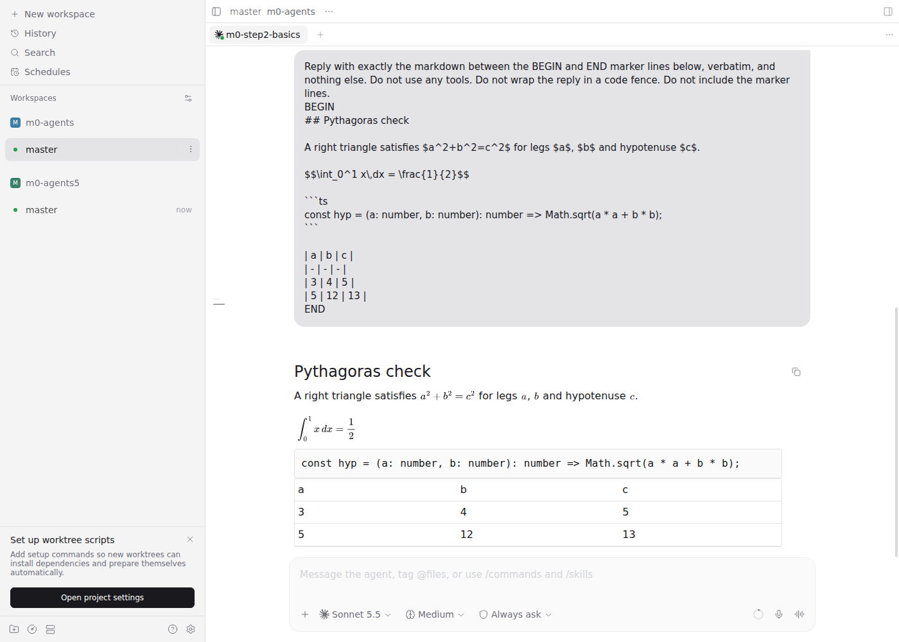
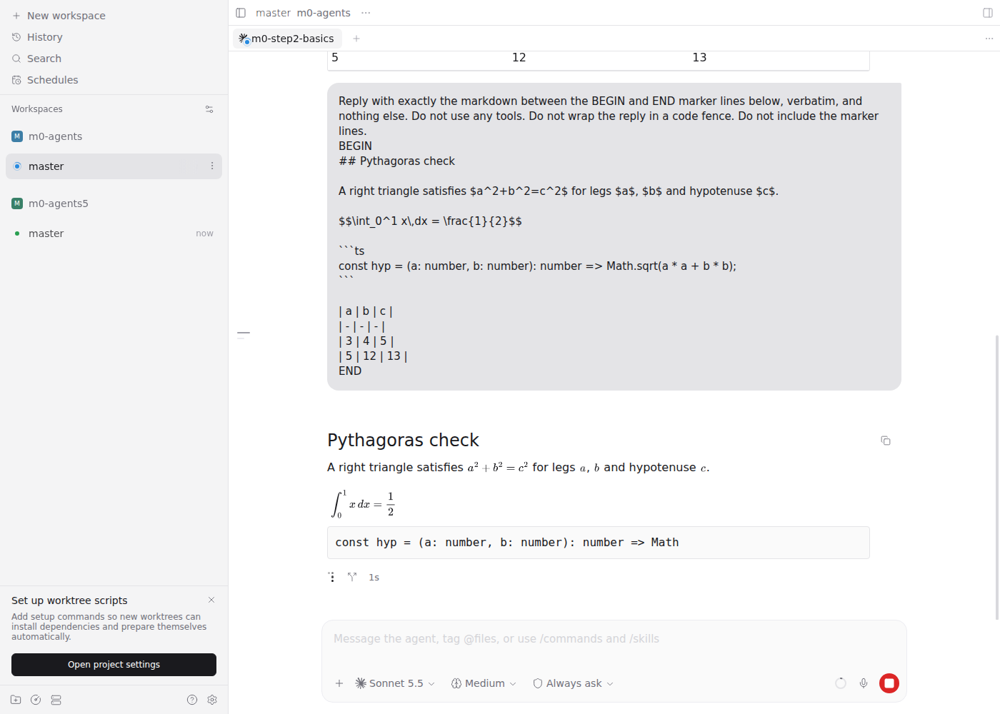
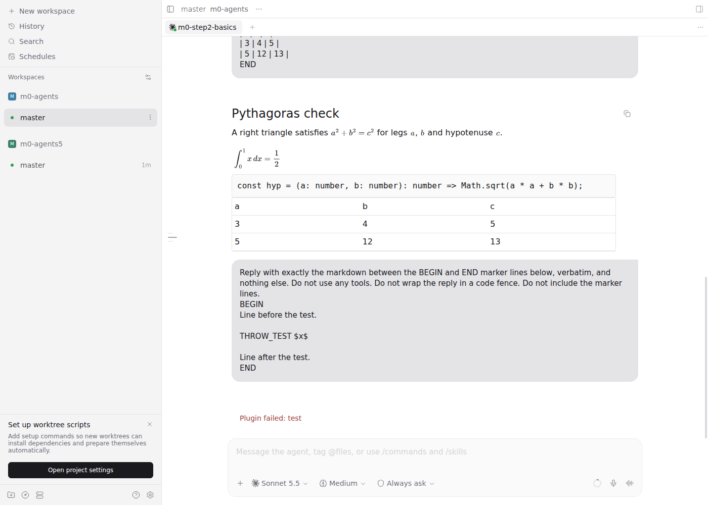
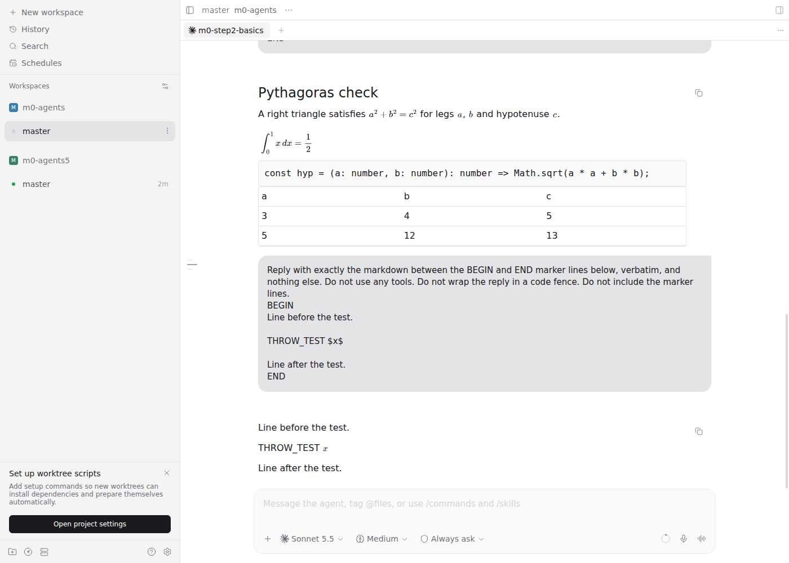
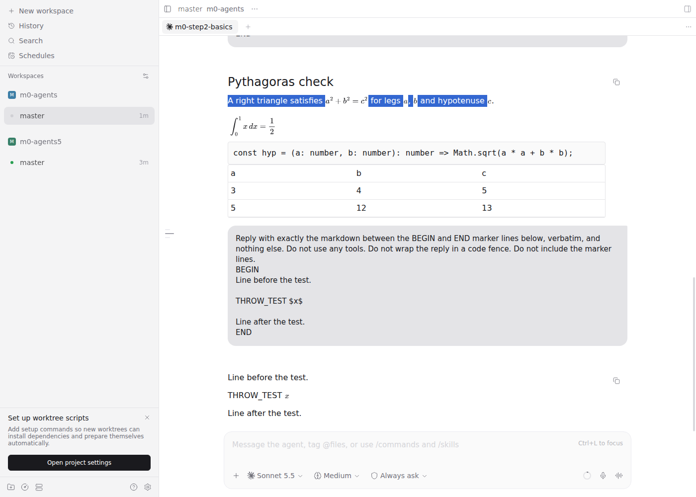
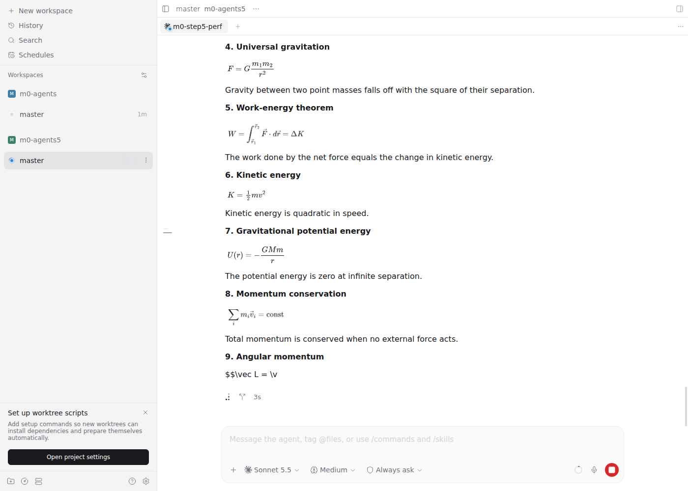
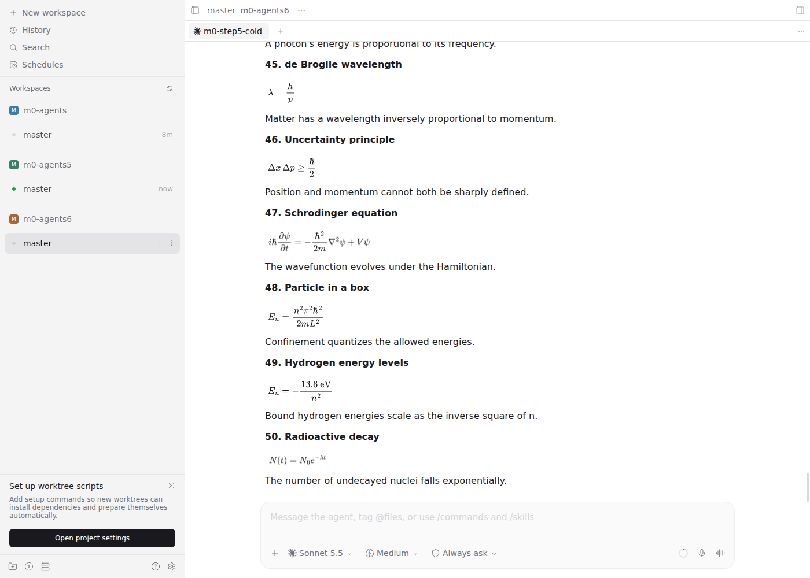
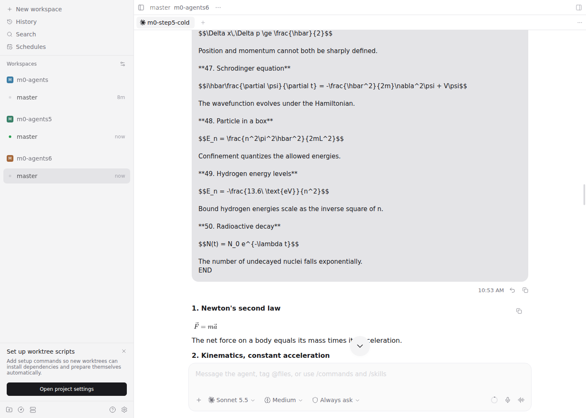
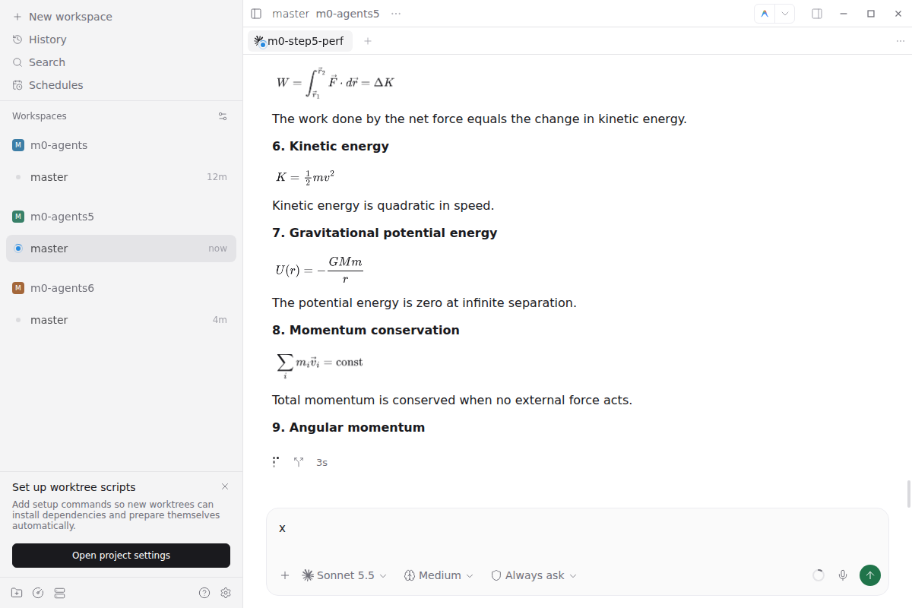
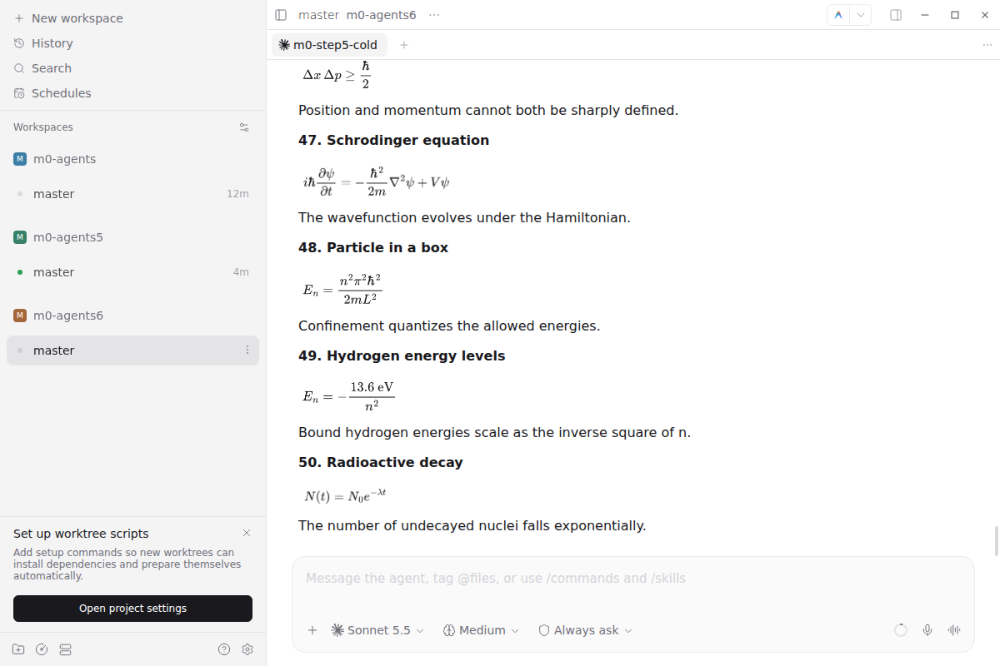

# Validation

Evidence that `q5m-math` works on an upstream Paseo 0.11.2 host. The final matrix comes first; the
milestone-0 evidence that gated the feature work follows it.

## Final matrix

Gathered on 2026-10-10 on the plugin at `a5be666` (`npm run build` from that commit, then
`plugin reload q5m-math` on the dev daemon; `plugin ls` shows `q5m-math running`). Host and dev daemon
are the milestone-0 setup below. Driver scripts were Playwright against Expo web (`http://localhost:8090`,
viewport 1400x1000) and against the Electron dev app over CDP (`PASEO_ELECTRON_REMOTE_DEBUGGING_PORT=9333`
under `xvfb-run`, window 1200x800), the same way milestone 0 did. iOS and Android are Joe's pass.

Test messages are exact-echo prompts in `docs/validation/prompts/` (`basics.txt`, `no-math.txt`,
`list-copy.txt`, `stream-long.txt`, `stream-host.txt`); the 50-formula prompt is
`docs/milestone-0/prompts/step5-50-formulas.txt`. They ran on the dev daemon workspaces `v9w` (basics,
no-math, list-copy) and `v9s` (streaming), both git repos under `/tmp` with `chart.png` (200x150) and
`big.png` (1800x1750).

| Check | Browser | Electron | iOS | Android |
| --- | --- | --- | --- | --- |
| Streamed math message reveals at host pace | Pass ([1](#streaming-pace)) | Pass ([1](#streaming-pace)) | Pass (Joe, 2026-10-10) | Pass (Joe, 2026-10-10) |
| Message without math matches host | Pass ([2](#message-without-math)) | Pass ([2](#message-without-math)) | Pass (Joe, 2026-10-10) | Pass (Joe, 2026-10-10) |
| Theme switch updates formulas and highlight colors | Pass ([3](#theme-switch)) | Pass ([3](#theme-switch)) | Pass (Joe, 2026-10-10) | Pass (Joe, 2026-10-10) |
| Invalid formula falls back to source | Pass ([4](#basics-message)) | Pass ([4](#basics-message)) | Pass (Joe, 2026-10-10) | Pass (Joe, 2026-10-10) |
| 50-formula message responsiveness | Pass ([5](#50-formula-message)) | Pass ([5](#50-formula-message)) | Pass (Joe, 2026-10-10) | Pass (Joe, 2026-10-10) |
| Highlighted fence | Pass, after [F1](#failures) fix | Pass, after [F1](#failures) fix (re-measured on Electron) | Pass (Joe, 2026-10-10) | Pass (Joe, 2026-10-10) |
| Workspace image renders | Pass ([4](#basics-message)) | Pass ([4](#basics-message)) | Pass (Joe, 2026-10-10) | Pass (Joe, 2026-10-10) |
| File path styled, press does nothing | Pass, mono font after [F1](#failures) fix | Pass, mono font after [F1](#failures) fix (re-measured on Electron) | Pass (Joe, 2026-10-10) | Pass (Joe, 2026-10-10) |
| Selection copy yields TeX | Pass ([6](#selection-copy)) | Pass ([6](#selection-copy)) | n/a | n/a |
| Phone load: plugin load after reconnect or app start, first highlighted fence render (client bundle grew) | Pending: Joe | Pending: Joe | Pass (Joe, 2026-10-10) | Pass (Joe, 2026-10-10) |

Any failed cell blocks cutover. F1 was the only failure and is fixed.

### Failures

**F1 (fixed): highlighted fence and inline code were proportional text on web and Electron.** In the
plugin row the fence's outer element computed `font-family: monospace`, but every token `<span>`
inside it computed `system-ui`, and so did inline code (`src/index.ts`). React Native Web nested
`Text` spans do not inherit `fontFamily` from the outer `Text`. The host's own fence
(`no-math.txt`) computes `SFMono-Regular, Menlo, Monaco, ...` on its token spans. Before the fix:
[basics-web.png](validation/basics-web.png), [basics-electron.png](validation/basics-electron.png),
against the host fence in [no-math-web.png](validation/no-math-web.png).

Fix: `MONO_FONT_FAMILY` in `client/highlight.tsx` (the host's `DEFAULT_MONO_FONT_STACK`) is set on
the fence and code-block text, the plain-text fallback, every line and token `Text`, and inline
code. `FilePathText` (the `[the notes](file)` link) stays in the body font like the host's link.
After the fix, Browser, computed style of the `basics` reply (`const`, `number`, `sqrt` token
spans and the `src/index.ts` inline code) is `SFMono-Regular, Menlo, Monaco, Consolas, "Liberation
Mono", "Courier New", monospace` for every element:
[basics-web-mono.png](validation/basics-web-mono.png). Electron, re-run after rebuilding and reloading
the plugin at `0d95af5` (same `basics.cjs` check over CDP, window 1200x800): the same computed value for
every fence token span, the fence outer element, and the `src/index.ts` inline code, with the same four
token colors, the path and link accent `rgb(32, 116, 74)`, and the invalid formula still shown as source.
Clicking the path and the link again left the URL, open pages, and chat DOM size unchanged, with no dialog,
popup, or toast: [basics-electron-mono.png](validation/basics-electron-mono.png).

| Element | Before | After |
| --- | --- | --- |
| Fence outer element font | `monospace` | `SFMono-Regular, Menlo, Monaco, ...` |
| Fence token span font | `system-ui` | `SFMono-Regular, Menlo, Monaco, ...` |
| Inline code font | `system-ui` | `SFMono-Regular, Menlo, Monaco, ...` |

### Basics message

`basics.txt` is one math message with an inline formula, a display formula, an invalid formula
(`$\frac{p}$`), a `ts` fence, an inline-code path, a file link, and two workspace images. The whole
reply is one plugin row (`q5m-math/<message id>/0`). Measured in the DOM on both targets:

| Check | Result (Browser = Electron) |
| --- | --- |
| Valid formulas | 6 ``, all decoded; `alt` is the TeX source |
| Invalid formula (4) | `$\frac{p}$` stays as source text, no error card, rest of message intact |
| Highlighted fence | 4 distinct token colors (`rgb(207, 34, 46)`, `rgb(130, 80, 223)`, `rgb(5, 80, 174)`, `rgb(36, 41, 47)`) on `rgb(250, 250, 250)`; mono font per F1 fix |
| Workspace image (4) | `chart.png` natural 200x150 renders 200x150; `big.png` natural 1800x1750 scales to the row (760x739 on web, 760x739 on Electron) |
| File path styled | `src/index.ts` and the link text both use the theme accent `rgb(32, 116, 74)`; inline code has the muted background |
| File path press does nothing | Click on `src/index.ts` and on the link text: URL, open pages, tab count, and chat DOM size unchanged; no dialog, popup, or toast |

Screenshots: [web](validation/basics-web.png), [Electron](validation/basics-electron.png),
[after pressing the path and link, web](validation/filepath-after-press-web.png),
[after pressing, Electron](validation/filepath-after-press-electron.png).

### Message without math

`no-math.txt` has a heading, an inline-code path, a link, `$5` and `$10` prices, a list, a `ts` fence,
and a table. The plugin did not take it over: its rows have plain message ids and
`data-testid="assistant-message"`, with no `q5m-math/` row. The five host rows' HTML (ids and `aria-*`
stripped) hashes to the same SHA-1 (`b7b379d1a83d796bd7b0e6435656c04e91d34c18`) with the plugin enabled
and with it disabled (`plugin disable q5m-math`, reload the page, then `plugin enable`), on both web
and Electron. Screenshots: [web](validation/no-math-web.png), [Electron](validation/no-math-electron.png).

### Theme switch

The app theme was set to `auto` and the page's `prefers-color-scheme` flipped light, dark, light with
the message mounted (no reload), then the named themes `claude` and `midnight` were selected (with
reload) because they have different accents. The original setting was restored.

| Theme | Page bg | Formula images | Fence token colors | Fence bg | Path and link color |
| --- | --- | --- | --- | --- | --- |
| light | `rgb(255, 255, 255)` | set A (6 hashes) | `rgb(207, 34, 46)` ... | `rgb(250, 250, 250)` | `rgb(32, 116, 74)` |
| dark | `rgb(24, 27, 26)` | set B, all 6 differ from A | `rgb(255, 123, 114)` ... | `rgb(30, 33, 32)` | `rgb(32, 116, 74)` (host accent is the same in light and dark) |
| light again | `rgb(255, 255, 255)` | set A again | same as light | same as light | same |
| claude | `rgb(31, 31, 30)` | set B | dark palette | `rgb(38, 37, 35)` | `rgb(217, 119, 87)` |
| midnight | `rgb(22, 24, 32)` | set B | dark palette | `rgb(28, 30, 39)` | `rgb(59, 111, 207)` |

Identical on web and Electron. Screenshots: [web light](validation/theme-web-light.png),
[web dark](validation/theme-web-dark.png), [web claude](validation/theme-web-claude.png),
[Electron light](validation/theme-electron-light.png), [Electron dark](validation/theme-electron-dark.png),
[Electron claude](validation/theme-electron-claude.png).

The plugin cannot read the host's syntax-highlight theme picker, so it uses the default light and dark
palettes from `@getpaseo/highlight` (noted at `client/highlight.tsx`). Its colors differ from a host fence
when the user picked another syntax theme.

### Streaming pace

`stream-long.txt` (three parts, 3.3 KB, formulas inline and display) against `stream-host.txt` (the same
text with every `$` removed, so the host renders it). A `requestAnimationFrame` sampler recorded the
visible text length of the new assistant rows. "Advanced" is the share of frames in the reveal window
that changed the text length. Gaps are between visible changes.

| Target | Message | First visible | Last change | Distinct states | Frames advanced | p50 / p95 / max gap | Largest single jump |
| --- | --- | --- | --- | --- | --- | --- | --- |
| Web | math (plugin) | 2.96 s | 9.17 s | 320 | 86% | 17 / 34 / 130 ms | 484 chars, at the end |
| Web | no math (host) | 2.41 s | 8.12 s | 129 | 38% | 17 / 216 / 349 ms | 245 chars |
| Electron | math (plugin) | 2.30 s | 8.55 s | 310 | 80% | 17 / 34 / 118 ms | 514 chars, at the end |
| Electron | no math (host) | 2.29 s | 8.02 s | 191 | 56% | 17 / 83 / 300 ms | 218 chars |

The plugin row grows steadily from the first character (about 15 characters to about 2300 over 5.5 s)
with smaller and more frequent steps than the host. Both snap at the end of the turn, as the host's
reveal does when the phase leaves `streaming`. The plugin's end snap is larger: 484 characters on web
and 514 on Electron, against 245 and 218 for the host's largest jump. Near the end the plugin row's
length also overshoots (to 2780) and then settles at 2357 characters. The cause of the overshoot is
unverified; one possible explanation is formula source showing briefly before its image replaces it,
but no check was run for it. Formula images appear during the stream
([mid-stream, web](validation/stream-math-web.png), [mid-stream, Electron](validation/stream-math-electron.png),
host for comparison: [web](validation/stream-host-web.png), [Electron](validation/stream-host-electron.png)).

### 50-formula message

Same scripts and definitions as Step 5 of milestone 0 (below), plugin at `a5be666`, dev Expo bundle,
no CPU throttle. Keystroke latency is Event Timing `duration` for one key per 1.5 s while streaming.

| Run | First row | All 50 images decoded | Long tasks (count / max / total) | Keystroke latency max |
| --- | --- | --- | --- | --- |
| Web | 2.5 s | 15.7 s (stream end - 0.1 s) | 25 / 114 ms / 1.65 s | 80 ms |
| Electron | 3.1 s | 16.1 s (stream end + 0.25 s) | 11 / 95 ms / 0.67 s | 64 ms |
| Milestone 0 web, for reference | 2.5 s | 15.2 s | 20 / 70 ms / 1.15 s | 80 ms |
| Milestone 0 Electron, for reference | 2.6 s | 15.9 s | 5 / 99 ms / 0.36 s | 32 ms |

An earlier web run in the same session gave 21 long tasks, max 94 ms, total 1.23 s, keystroke 72 ms.
Run-to-run spread is wider than the difference from milestone 0.

Open and scroll, one agent with one 50-formula reply (`m0-agents6`):

| Run | Open to fully rendered | Long tasks during open | Scroll frames over 50 ms | Max frame gap |
| --- | --- | --- | --- | --- |
| Web | 936 ms | 3, max 210 ms | 0 of 210 | 17 ms |
| Electron | not meaningful (92 ms; the window was already on that workspace) | 0 | 0 of 211 | 17 ms |

Verdict: no visible input or scroll lag on web or Electron at native CPU speed. Phone-class
performance is Joe's pass. Screenshots: [web mid-stream](validation/50-formulas-web-streaming.png),
[Electron mid-stream](validation/50-formulas-electron-streaming.png).

### Selection copy

Message `list-copy.txt` (a paragraph with `$E=mc^2$`, a plain list, a list whose second item has `$x^2$`).
Text was selected with a real mouse drag and copied with `Control+C`; the clipboard was read back. A
sentinel was written to the clipboard before each copy. Identical on web and Electron.

| Selection | Clipboard |
| --- | --- |
| Paragraph "Intro line" to "a paragraph." | `Intro line with $E=mc^2$ inside a paragraph.` |
| Plain list, `alpha item` to `beta item` | `alpha item\nbeta item` (browser default; the plugin leaves it alone) |
| Formula list, `gamma item` to `inside` | `- gamma item\n- delta has $x^2$ inside` |
| Formula list, `delta has` to `inside` only | `- gamma item\n- delta has $x^2$ inside` |

The last row copies the whole list block's source even though only the second item was selected. That
is the designed behavior for any selection inside a multi-line block that contains a formula (the
rendered list has no separators to rebuild from); it is recorded here so it is not read as a bug.
Screenshots: [paragraph, web](validation/copy-web-paragraph.png), [formula list, web](validation/copy-web-list-formula.png),
[plain list, web](validation/copy-web-list-plain.png), [paragraph, Electron](validation/copy-electron-paragraph.png),
[formula list, Electron](validation/copy-electron-list-formula.png), [plain list, Electron](validation/copy-electron-list-plain.png).

### Joe's device pass

iOS and Android passed on 2026-10-10 (see Device results below). To repeat, use a phone app on Paseo 0.11.x. Connect it to the dev daemon with the
pairing steps in [Connect a phone to the dev daemon](#connect-a-phone-to-the-dev-daemon) below (use
`env -u PASEO_HOME` and `--home`, or you pair the production daemon on 6767).

Workspaces on the dev daemon for this pass:

| Workspace | Agent | Use |
| --- | --- | --- |
| `v9w` | `v9w-matrix` | Basics message, no-math message, list-copy message |
| `v9s` | `v9s-stream` | Send `docs/validation/prompts/stream-long.txt` and `stream-host.txt` to watch the pace |
| `m0-agents5` / `m0-agents6` | `m0-step5-perf` / `m0-step5-cold` | 50-formula streaming / open and scroll |

The `v9w`, `v9s`, and `m0-agents*` workspaces are directories under `/tmp` on the dev host. They are lost
on a reboot or `/tmp` cleanup; recreate them from the prompts in `docs/validation/prompts/` if so.

Check on each phone, one row per matrix row:

1. Pace: send `stream-long.txt` to `v9s-stream`. Formulas and text appear steadily, no long freeze, ends
   without a visible lurch. Compare with `stream-host.txt` (same text, no math, host-rendered).
2. No math: in `v9w-matrix`, the "No formulas here" message looks like any other host message (heading,
   list, fence, table, `$5` and `$10` as plain text).
3. Theme: switch Settings > Appearance > Theme between Light and Dark (and `claude` for a different
   accent). Formulas re-color, fence token colors change, the file path and link follow the accent.
4. Invalid formula: in the "Validation basics" message, `$\frac{p}$` shows as source text and the rest of
   the message renders.
5. 50 formulas: use `m0-agents6` (open and scroll) and `m0-agents5` (send "Repeat your previous reply
   exactly." and type in the composer while it streams). Visible lag blocks rollout.
6. Highlighted fence: colors are present and the fence and inline code are monospace (F1 was fixed on
   web and Electron). Record whether native is monospace.
7. Image: `chart` renders about 200x150 (not stretched to the full width); `big chart` fits the width.
8. File path: `src/index.ts` and "the notes" use the accent color. Tap both: nothing happens.
9. Selection copy: n/a on phones.
10. Load timing (the client bundle grew from about 0.6 MB to about 2.1 MB with the highlighter; it is
    evaluated lazily but still downloaded and parsed on the phone). Time with a stopwatch or screen
    recording, and record seconds per case:
    - Plugin load: force-quit the app (or toggle airplane mode off to reconnect), reopen it on `v9w-matrix`,
      and time from the app showing the chat to the "Validation basics" formulas appearing. Compare with
      `no-math.txt`, which never loads the plugin.
    - First highlighted fence: after a cold start, scroll to the first `ts` fence in "Validation basics" and
      time from the fence entering view to colored tokens. Note any blank or unstyled flash.
    A visible stall on either blocks rollout.

Record the result per row (rows 1-10) under "Device results" here.

#### Device results

2026-10-10, Joe: iOS and Android pass rows 1–10.

---

## Milestone 0: q5m-math on an upstream Paseo 0.11.2 host

Evidence gathered on 2026-10-10. This gates the feature work in Tasks 3-9.

### Setup

| Item | Value |
| --- | --- |
| Host | `getpaseo/paseo` `7868f5caf6515543a81ffc58fe941e15e917dcf9` (0.11.2), detached worktree `/home/joe/code/zge-workspace/worktrees/paseo/upstream-host` |
| Dev daemon | `127.0.0.1:6768`, `PASEO_HOME=/home/joe/code/zge-workspace/worktrees/paseo/upstream-host/.dev/paseo-home`, server id `srv_Z98dM6DGlpRu` |
| Plugin | this branch at `6647edf`, installed with `npm run cli -- plugin install /home/joe/code/zge-workspace/worktrees/paseo-math/upstream-0-11`; `plugin ls` shows `q5m-math running` |
| Web client | `scripts/dev-app.sh` with `EXPO_PORT=8090` (port 8081 is taken on this machine) |
| Electron | `npm run dev:desktop` under `xvfb-run`, driven over CDP (`PASEO_ELECTRON_REMOTE_DEBUGGING_PORT=9333`) |
| Browser | Playwright 1.58.2, `chromium-headless-shell` 1208, viewport 1400x1000 |
| Agent | Claude `claude-sonnet-5-5` on the dev daemon |

Upstream installs plugins disabled until the root config field `pluginsEnabled` is `true`
(upstream `docs/plugins.md`). It was set in the dev home's `config.json` only, then applied with
`npm run cli -- reload`.

For deterministic messages each prompt asks the agent to echo exact markdown verbatim. The prompts
are in `docs/milestone-0/prompts/`.

The web client is the Expo development bundle (React dev mode). Absolute timings are therefore
pessimistic compared with a production build. Plugin-on versus plugin-off comparisons use the same
bundle.

### Step 2: basics on web

Prompt: `docs/milestone-0/prompts/step2-basics.txt` (heading, paragraph with `$a^2+b^2=c^2$`, a
display integral, a `ts` fence, a table).

- Formulas render. Inline and display math are daemon-rendered PNG `` elements whose `alt` is
  the TeX source. The whole reply is one plugin row,
  `data-message-id="q5m-math/<message id>/0"`.
- The heading, code fence, and table render. The `ts` fence has no syntax highlighting. Task 4 is the
  place to address that.
- The message streams in. A screenshot taken mid-stream shows a cut-off code line
  (`... => Math`) while the stop button is visible. The 50-formula run below has 95-113 distinct
  intermediate states.





### Step 3: renderer throw

With `if (text.includes("THROW_TEST")) throw new Error("test");` temporarily added after
`const { text } = item.data;` in `MathMessageView` (`client/math-message.tsx`), the plugin was
rebuilt and reloaded. The agent then replied with `docs/milestone-0/prompts/step3-throw.txt`:
"Line before the test." / "THROW_TEST $x$" / "Line after the test.".

**Finding: the host shows an error card.** The row contains only red text `Plugin failed: test`. It
is neither empty nor source text. The whole message is hidden, including the two plain lines. Other
rows render normally. The card comes from the host's `SurfaceErrorBoundary`
(`packages/app/src/plugins/timeline/view.tsx:83`, no `renderError`, `resetKey={item.data}`), so a
new streamed update resets it.

The brief's literal condition ("if the row is empty") does not apply. However, the card does not
meet the global constraint "Every failure degrades to raw source for the affected part only". The
Task 3 error boundary that renders `<Text selectable>{text}</Text>` is still needed to meet that
constraint.

The line was then removed, and the plugin was rebuilt and reloaded. The same row then rendered
"Line before the test. / THROW_TEST x / Line after the test." `git status` showed no change to
`client/math-message.tsx`.





### Step 4: selection-copy spike

The brief's two listeners were installed with `page.evaluate`. Two probes were added: a bubbling
listener on the plugin row element, and a bubbling listener on `window`. The `window` listener runs
after React's root-container listener, which is where the host's `onCopy` runs. Text was selected
with a real mouse drag, from "A right triangle" across the inline formulas to "hypotenuse". The
copy was a real `Control+C`, with clipboard permissions granted.

Plugin row (`q5m-math/msg_011Cfttm86NqatWyAA6n3mQx/0`), in listener order:

```
document copy false
message row copy (bubble) false
row copy (bubble) false
window copy (bubble, after React root) false clipboardData text/plain="" types=[]
```

Clipboard `text/plain`: `"A right triangle satisfies \n for legs \n, \n and hypotenuse \n"`.
The formulas are missing: the browser's default copy drops the `` alt text. The `text/html`
part is RN-web spans with inline styles.

Control: a host-rendered assistant row ("OK"), triple-clicked and copied:

```
document copy false
message row copy (bubble) false
row copy (bubble) false
window copy (bubble, after React root) true clipboardData text/plain="OK" types=["text/plain","text/html"]
```

So the host's handler (`AssistantSelectionCopySurface`, a React `onCopy` on a wrapper `div`) runs
after every native bubbling listener inside the chat. It calls `preventDefault()` only when the
selection starts and ends inside `[data-testid="assistant-message"]` (`createAssistantSelectionClipboardContent`
returns `null` otherwise). For a selection inside a plugin row it does not prevent default.

**Decision for Task 7: branch 1.** The host's handler does not prevent default for selections inside
a plugin row, and it runs after the row's bubbling listener. The plugin handles `copy` on its own row
element in the bubble phase and calls `preventDefault()` and `stopPropagation()`. The capture-phase
document listener branch is not needed.

Electron loads the same `surface.web.tsx` (there is no `.electron` variant), so the same order
applies there. The spike was run on web only.



### Step 5: 50-formula message

Prompt: `docs/milestone-0/prompts/step5-50-formulas.txt` (50 numbered physics equations, each a
bold title, a `$$` display equation, and one sentence; 4018 rendered characters, 50 formula images).

Definitions:

- **Streaming**: from send to the last formula image decoded. Sampled every 100 ms in the page.
- **Long tasks**: `PerformanceObserver` `longtask` entries (>= 50 ms).
- **Keystroke latency**: Event Timing `duration` for keys typed into the composer once per 1.5 s
  while the reply streams.
- **Open**: from clicking the workspace in the sidebar to all 50 images decoded.
- **Scroll**: 40 wheel steps of 150 px up and 40 down, frame gaps from `requestAnimationFrame`.

#### Streaming

| Run | First row | All 50 images decoded | Long tasks (count / max / total) | Keystroke latency max |
| --- | --- | --- | --- | --- |
| Web, plugin on | 2.5 s | 15.2 s (stream end + <0.1 s) | 20 / 70 ms / 1.15 s | 80 ms |
| Web, plugin off (host Markdown) | 2.5 s | n/a | 3 / 88 ms / 0.21 s | 48 ms |
| Electron, plugin on | 2.6 s | 15.9 s (stream end + <0.1 s) | 5 / 99 ms / 0.36 s | 32 ms |
| Web, 4x CPU throttle, plugin on | 2.9 s | 17.1 s | 77 / 363 ms / 12.2 s | 280 ms |
| Web, 4x CPU throttle, plugin off | 3.3 s | n/a | 108 / 408 ms / 13.0 s | 168 ms |

A second plugin-on web run without the typing probe gave 18 long tasks, max 65 ms. A run with a
Chromium trace recording showed a 434 ms task, which was a minor GC inflated by tracing. The
untraced numbers above are the ones to use.

Formula images keep up with the stream: the last image decodes within one 100 ms sample of the last
text change. Incomplete display math shows as source (`$$\vec L = \v`) until its closing `$$`
arrives. See the streaming screenshot.

#### Open and scroll (one agent, one 50-formula reply)

| Run | Open to fully rendered | Long tasks during open | Scroll frames >50 ms | Max frame gap |
| --- | --- | --- | --- | --- |
| Web, plugin on | 984 ms | 2, max 206 ms | 0 of 210 | 17 ms |
| Web, plugin off | 890 ms | 2, max 515 ms | 0 of 211 | 17 ms |
| Electron, plugin on | 870 ms | 2, max 177 ms | 0 of 210 | 17 ms |
| Web, 4x throttle, plugin on | 3630 ms | 9, max 919 ms | 0 of 225 | 33 ms |
| Web, 4x throttle, plugin off | 4032 ms | 8, max 2564 ms | 1 of 245 | 67 ms |

**Verdict: no visible input or scroll lag on web or Electron.** Scrolling holds 60 fps. During
streaming, keystrokes paint within 80 ms on web and 32 ms on Electron. Compared with host-only
Markdown, the plugin adds about 1 s of main-thread work over a 15 s stream at native speed.

Under a 4x CPU throttle (dev bundle), the whole streaming path saturates the main thread whether
the plugin is on or off. The per-update cost grows with message length: tasks grow from about
100 ms to about 300 ms as the reply nears 50 formulas. That is a phone-class risk, and only Joe's
device pass can settle it.











### Device pass (milestone 0)

iOS and Android were not checked. Joe runs these against the same dev daemon.

#### Connect a phone to the dev daemon

Use a phone app on Paseo 0.11.x to match the 0.11.2 daemon; other app versions were not tested
against this plugin. Relay is enabled on the dev daemon. Run this on the laptop:

```bash
cd /home/joe/code/zge-workspace/worktrees/paseo/upstream-host
env -u PASEO_HOME npm run cli -- daemon pair --home /home/joe/code/zge-workspace/worktrees/paseo/upstream-host/.dev/paseo-home
```

`env -u PASEO_HOME` and `--home` matter. A terminal opened inside Paseo inherits
`PASEO_HOME=~/.paseo`, which would pair the production daemon on 6767 instead. The command prints
a QR code and an `https://app.paseo.sh/#...` link. In the phone app, scan the QR code, or choose
**Paste pairing link**. The host appears with server id `srv_Z98dM6DGlpRu`.

Workspaces already on the dev daemon:

| Workspace | Agent | Contents |
| --- | --- | --- |
| `m0-agents` | `m0-step2-basics` | Step 2 replies, the `THROW_TEST` row (now renders normally) |
| `m0-agents5` | `m0-step5-perf` | Several 50-formula replies; use for streaming |
| `m0-agents6` | `m0-step5-cold` | Exactly one 50-formula reply; use for open and scroll |

To stream a fresh 50-formula reply, send "Repeat your previous reply exactly." to `m0-step5-perf`
from the phone. You can also send the prompt file from the laptop:
`env -u PASEO_HOME npm run cli -- send <agent id> --prompt-file /home/joe/code/zge-workspace/worktrees/paseo-math/upstream-0-11/docs/milestone-0/prompts/step5-50-formulas.txt`.

#### Check on iOS and on Android

1. Step 2: in `m0-agents`, inline and display formulas render as images, and the heading, code
   fence, and table render. Send the Step 2 prompt again and watch it stream in.
2. Step 3 outcome on native: the host error card is `Plugin failed: <message>` on web. Native uses
   the same boundary (`plugins/timeline/view.tsx` has no platform variant). No re-test is needed unless the plugin changes. Confirm that the
   `THROW_TEST` row in `m0-agents` shows "Line before the test. / THROW_TEST x / Line after the
   test.".
3. Step 5: open `m0-agents6` and note the time until all 50 formulas show. Scroll the reply top to
   bottom quickly. Then, in `m0-agents5`, send the repeat prompt, type in the composer while it
   streams, and scroll during the stream.
4. Record whether input or scroll lag is visible. Visible lag blocks rollout. Compare it to a
   host-only message of similar length if unsure: disable with
   `env -u PASEO_HOME npm run cli -- plugin disable q5m-math` and re-enable with `plugin enable`,
   run from the host checkout.

Record the results here under "Device results".

#### Device results

This section covers milestone 0 only. The final matrix's phone results are under "Device results" in
"Joe's device pass" above.

2026-10-10, Joe: iOS and Android pass — formulas render and stream; no visible input or scroll lag.
